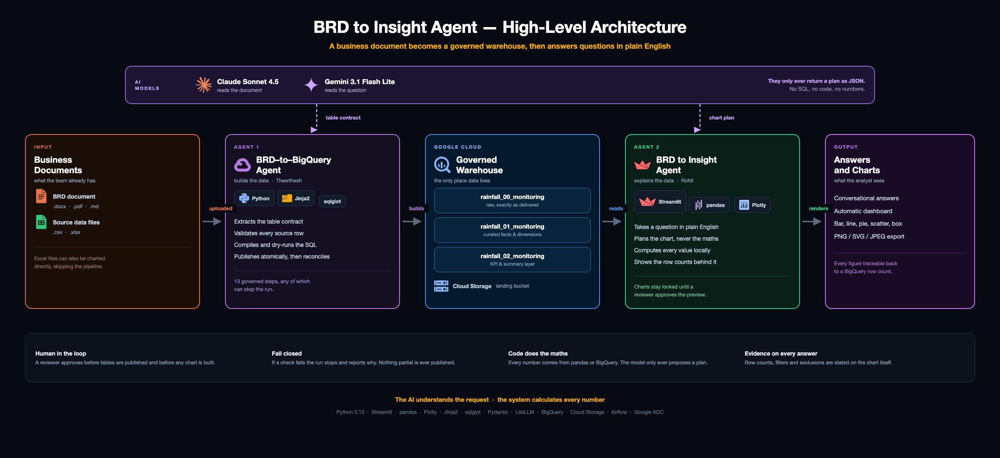

# BRD to Insight Agent

Two-agent system that turns a business requirements document into governed BigQuery tables, then lets anyone ask questions of those tables in plain English and get charts back — no SQL, no formulas. The model only ever proposes a plan; every number on every chart is calculated locally by pandas or by BigQuery.

Works standalone too: upload an Excel or CSV file and chart it without any pipeline.

## Stack

- **App** (`app.py`, `brd_insight_agent/`): Python 3.12, Streamlit, pandas/NumPy for all computation, Plotly + Kaleido for rendering and export, google-genai for Gemini through either the native API or a LiteLLM proxy.
- **Pipeline** ([brd-to-bigquery-agent](https://github.com/thc-clgx/brd-to-bigquery-agent)): separate repository, reached as a subprocess. Python, Jinja2 SQL templating, sqlglot for SQL validation, Claude Sonnet 4.5 via LiteLLM, BigQuery + Cloud Storage with Google ADC.
- **Warehouse**: BigQuery, three managed layers — `00_` raw, `01_` curated facts, `02_` KPI summaries.

## Run locally

```bash
python3.12 -m venv .venv
.venv/bin/python -m pip install -r requirements.txt
cp .env.example .env            # configure direct Gemini or the LiteLLM proxy
.venv/bin/python -m streamlit run app.py --server.address 127.0.0.1 --server.port 8511
```

App: <http://127.0.0.1:8511>

On Windows use `.\run.ps1 -Setup` once, then `.\run.ps1`.

To route through a LiteLLM proxy, set `LITELLM_BASE_URL`, `LITELLM_API_KEY` and `LLM_MODEL` in `.env`. Both the URL and the key must be present or the proxy is ignored. When they are blank the app uses `GEMINI_API_KEY` and `GEMINI_MODEL`. There is no model fallback: if the configured model is unavailable the request fails and says so.

The GitHub copy excludes `.env`, virtual environments, the bundled interpreter, development screenshots and internal working notes. Create and configure `.env` locally before running. A virtual environment records absolute paths, so if you move or rename the project folder, delete `.venv` and rebuild it.

Export needs Chrome or Chromium installed; without it charts still display but downloads fail. The BRD-to-BigQuery path additionally needs the Google Cloud SDK and `gcloud auth application-default login`.

## Charting an Excel file

Choose **Excel upload**, drop in one or more workbooks, and pick a sheet. The first chat message lists only the chart types this sheet can actually produce and explains why each other type is unavailable — a line chart needs a date column with at least two distinct dates, for example. Choosing a type lists suggestions validated against the complete sheet. Click a suggestion or reply "the second one"; "recommendation 2" also works later and starts a fresh chart of the whole sheet. Suggestions are generated locally with no model calls, and they are starting points, not a restriction on what you can ask for.

Ask for whatever you want in the chat box: *"bar chart of total revenue by region"*, *"make it horizontal"*, *"only 2025"*, *"new chart: line chart of orders by month"*. Prefix a request with **New chart:** when you want to start over rather than refine the current image. Each image can hold up to four charts.

Use **Filter data** to scope the sheet before charting — calendar years and quarters actually present in the data, category values, numeric ranges and booleans. Choices come from the real column values and the matched row count is computed locally. The scope applies to every new image, combines with any filter you ask for in chat, is shown on the chart itself, and is kept with each saved version.

Use **Correct column format** for number separators, currency removal, percentage scaling, exact date formats, booleans or text. Failed conversions never change the data; successful ones start a new dataset revision.

Rates, percentages and identifiers are never summed. Ask for *"sum the damage rate by carrier"* and the app refuses and offers the average instead, rather than returning a meaningless total. Invalid colors and unsupported chart combinations are rejected rather than silently substituted. Every chart states its row count and any exclusion on the image.

Select **Prepare image** to render PNG, SVG or JPEG at a chosen size. Exports use the selected immutable revision, so an older version in the image history still exports exactly as it was built.

## Building tables from a BRD

Choose **BRD to BigQuery**, upload exactly one BRD (`.docx`, text `.pdf`, `.txt`, `.md`) together with the CSV/Excel sources it registers, and press **Run**. **Dry run first** is ticked by default; clear it to let the framework write to GCS and BigQuery.

The framework's progress streams into the app line by line as it authenticates, extracts the table contract, validates every source row, compiles and dry-runs the SQL, provisions the tables, loads the raw layer, runs the BRD's own worked examples as acceptance tests, publishes atomically, and reconciles the published row counts. Any of those steps can stop the run; if one does, the app shows the framework's correction report verbatim rather than working around it.

If the tables already exist the run is skipped and the app says so, showing each table's live row count and last-modified time as evidence. Tick **Force re-run** to build them again anyway. **Table build** replays the recorded build of the existing tables step by step, then verifies the current state of every managed dataset live against BigQuery.

Before any chart is drawn you must check the previews against BigQuery and press **Approve and build dashboard**. Each table expands to show its real rows, row count and column count, with a link to open it in the BigQuery console. Charts stay locked until you approve.

Curated `01_` and KPI `02_` tables are offered for charting; raw `00_` tables are not. The sibling `00`/`01`/`02` datasets are discovered automatically from the one you configure, so a table in `..._02_monitoring` is readable while `BRD_BQ_DATASET` still points at `..._01_monitoring`. Pick a table from the sidebar and it behaves exactly like a worksheet — same chat, same filters, same exports.

Without `BRD_BQ_PROJECT`, or without `google-cloud-bigquery` installed, tables are read from a simulated warehouse: local files in `testdata` stand in for tables. Rows are real file contents, never generated values, and the UI labels the run and the read as simulated.

## Privacy

Approve column-name sharing per dataset before the model is called; the approval resets when you switch tables, by design. Raw rows and numeric summaries are never sent. Your messages and prior specifications can contain values, so inspect the last-request metadata and use synthetic or company-approved data. Withheld-column references and common secret/PII patterns are checked, but these are safeguards, not a DLP guarantee. Provider retention depends on your account terms.

A request is sent once. One automatic retry is made when the model reports a server-side overload (HTTP 503) or drops the connection. Quota, authentication and malformed-request errors are never retried, and the error states how many attempts were actually made.

## Limits

10 files, 100 MiB each, 250 MiB combined; 256 MiB loaded frame; 128 MiB saved image data; 20 saved datasets, 30 versions each; 100 messages of 8,000 characters. Reaching a limit is explicit — results are never silently evicted, so download what you need before clearing history. Override the budgets with `CHART_MAX_UPLOAD_MB`, `CHART_MAX_FRAME_MB` and `CHART_MAX_RESULTS_MB`, read at startup. BigQuery reads default to 200,000 rows per table (`BRD_BQ_ROW_LIMIT`, maximum 1,000,000) and any truncation is disclosed on screen. Formula cells use cached Excel values; formulas and macros are not executed.

## Wiring the pipeline

```bash
export BRD_AGENT_MODE=cli
export BRD_AGENT_DIR=/path/to/brd-to-bigquery-agent
export BRD_AGENT_CMD="/path/to/brd-to-bigquery-agent/.venv/bin/python /path/to/brd-to-insight-agent/brd_insight_agent/framework_launcher.py -m src.orchestrator.managed_runner --brd {brd} --source-root {source_dir}"
export BRD_BQ_PROJECT=your-project
export BRD_BQ_DATASET=your_dataset
```

`framework_launcher.py` switches the framework's progress logging on before starting it, so the run appears line by line instead of silently; its `managed_runner` entry point never calls its own `setup_logging`, which would otherwise leave the root logger at WARNING and print only the closing JSON summary. Arguments, exit codes and that summary pass through unchanged. The framework needs its own `.env` (`LLM_PROVIDER`, `LLM_MODEL`, `LLM_API_KEY`, `GOOGLE_CLOUD_PROJECT`) and Google ADC; without them it stops with status `BLOCKED` and a correction report.

Other variables: `BRD_AGENT_TIMEOUT` (default 900 s), `BRD_AGENT_LOG_LEVEL` (default `INFO`), `BRD_AGENT_DRYRUN_FLAG` (default `--dry-run`), `BRD_AGENT_CALLABLE` for `module` mode, and `BRD_AGENT_MODE=demo` to state plainly that no framework ran.

## Tests

```bash
.venv/bin/python -B -m unittest discover -s tests
.venv/bin/python verify_workflow.py --workbook testdata/retail_sales.xlsx
```

280 tests. The acceptance runner drives the actual chat, validation and rendering path; offline mode mocks only the model response. `--live` permits at most three real calls and stops on failure or quota, `--render` writes PNG/SVG/JPEG to `.validation/`. Checks compare exact filtered records and grouped values, not merely whether a chart was constructed.

## Architecture


